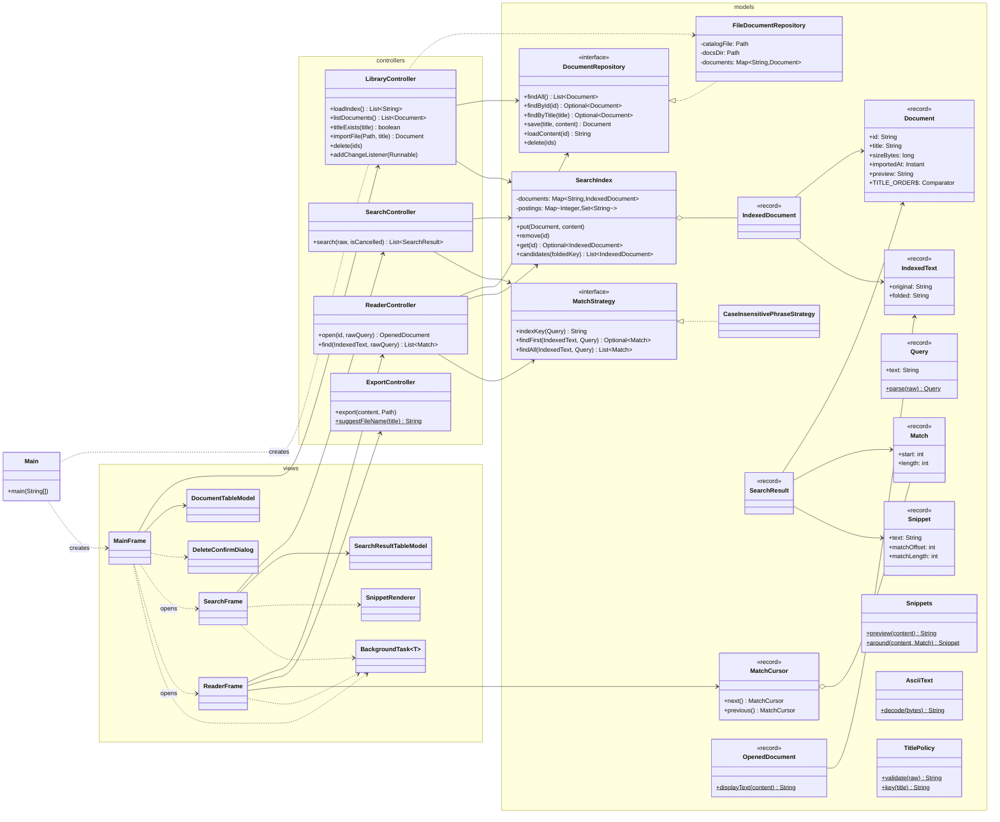
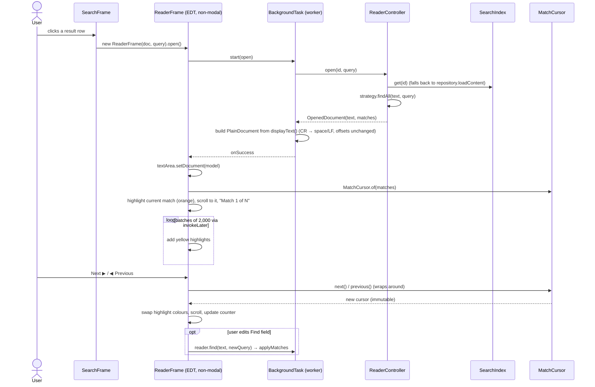
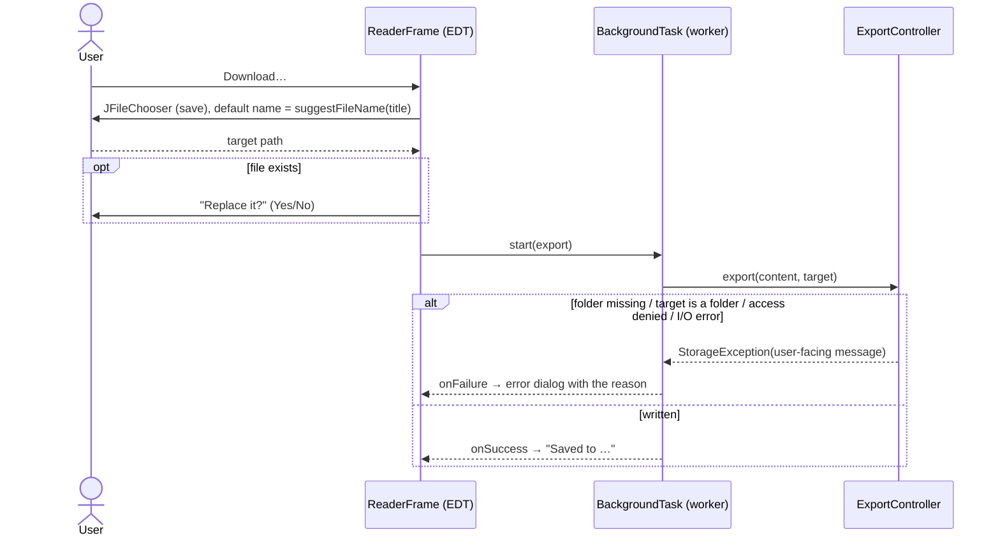

# Local Search Engine: Design Document

| | |
|---|---|
| **Language / UI** | Java 17, Swing |
| **Architecture** | MVC: `models`, `controllers`, `views` packages (plus `app` for wiring) |
| **Build** | Plain `javac` + `jar` scripts in [`/build`](../build), JUnit 5 console launcher |
| **Status** | Use cases #1–#5 implemented; 89 unit/integration tests; 90% line coverage on models + controllers |

---

## 1. Goals and Non-Goals

### 1.1 Goals

1. **Import** (UC#1): store a read-only copy of an ASCII text file under a user-chosen title. Later edits to the original do not change the copy. Re-importing a title replaces the old copy.
2. **Search** (UC#2): case-insensitive phrase search over every document, following the spec's matching rules. Results show the title and a snippet with up to 40 characters before and after the first match.
3. **Manage** (UC#3): a main table, ordered by title, with a 500-character preview and a delete checkbox per document. Deleting asks for confirmation in a scrollable dialog.
4. **Read** (UC#4): a separate, non-modal frame per document with every match highlighted, a match counter and circular Previous/Next.
5. **Download** (UC#5): save a document to a path the user chooses. Any failure is reported in an error dialog.
6. **The GUI never freezes.** No disk I/O, search or large text work runs on the Swing event dispatch thread (EDT).

### 1.2 Performance targets

These targets are set against things users already know. A web search answers in about 200–500 ms, a browser loads a page in about 1–2 s, and a UI action feels instant under 100 ms (Nielsen's limits).

| Operation | Target | Measured (dev laptop, JDK 17) | How |
|---|---|---|---|
| Search, 30 docs / ~33 MB total, selective phrase | < 100 ms | **0.9 ms** (asserted < 500 ms in `SearchControllerTest.searchingLargeCorpusIsFast`) | Trigram prefilter + `String.indexOf` on candidates only |
| Search, worst case (query < 3 chars → full scan of ~33 MB) | < 300 ms | **13.8 ms** | Runs in a background worker and is cancelled when the user keeps typing |
| Import a 5 MB file | < 1 s | **84 ms** | Read, validate, write copy, build trigrams, all off the EDT |
| Open a 5 MB document (263k matches) | < 1 s | **206 ms** to build matches + text model | Swing text model built off the EDT; highlights added in batches of 2,000 |
| Longest EDT task | < 100 ms | Bounded by batch sizes | See §3.4 |

Measured with a throwaway benchmark harness against `out/classes` (5 warm-up runs, averaged over 5–20 runs).

### 1.3 Non-goals

- Non-ASCII encodings. The spec says documents are English ASCII text, and files with other bytes are rejected with a clear message. Supporting them would only mean changing `AsciiText` (see §5).
- Ranking, stemming, fuzzy matching, boolean operators.
- Editing documents. Stored copies are immutable by design.
- Multi-user or networked use.
- Corpora larger than RAM. Every document's text is held in memory (see §2.6, decision D2).

---

## 2. Design

### 2.1 Package structure (MVC)

```
main/
├── app/          Main: composition root, the only class that names concrete implementations
├── models/       Data and domain rules: Document, DocumentRepository, FileDocumentRepository,
│                 SearchIndex, MatchStrategy, Query, Match, Snippet(s), MatchCursor, policies
├── controllers/  Business operations per use case: LibraryController (UC#1, #3),
│                 SearchController (UC#2), ReaderController (UC#4), ExportController (UC#5)
└── views/        Swing frames, dialogs, table models, BackgroundTask (SwingWorker wrapper)
```

Dependency rule: `views → controllers → models`. Models never import Swing. Controllers never import Swing. This is why every rule in the app can be unit-tested without clicking buttons.

### 2.2 Class diagram



### 2.3 Sequence diagrams

#### UC#1: Load a document into the system

```mermaid
sequenceDiagram
    actor User
    participant MF as MainFrame (EDT)
    participant BT as BackgroundTask (worker)
    participant LC as LibraryController
    participant AT as AsciiText
    participant Repo as FileDocumentRepository
    participant Idx as SearchIndex

    User->>MF: File → Import…
    MF->>User: JFileChooser (open)
    User-->>MF: picks file
    MF->>User: "Title for this document:" (default = file name)
    User-->>MF: title
    MF->>LC: titleExists(title)
    alt title already exists
        MF->>User: "Replace it?" (Yes / No = re-prompt / Cancel)
    end
    MF->>BT: start(importFile)
    MF-->>User: status "Importing…" + progress bar (UI stays live)
    BT->>LC: importFile(path, title)
    LC->>LC: TitlePolicy.validate, size ≤ 64 MB
    LC->>AT: decode(bytes)
    alt non-ASCII byte
        AT-->>LC: InvalidDocumentException
        LC-->>BT: throws
        BT-->>MF: onFailure → error dialog
    else valid
        LC->>Repo: save(title, content)
        Repo->>Repo: write temp → move to docs/<uuid>.txt → set read-only
        Repo->>Repo: write catalog.properties atomically
        Repo-->>LC: Document
        LC->>Idx: remove(old id) if replaced; put(doc, content)
        LC-->>MF: change listeners → invokeLater(refresh)
        BT-->>MF: onSuccess → status "Imported …"
    end
```

#### UC#2: Search a document

```mermaid
sequenceDiagram
    actor User
    participant SF as SearchFrame (EDT)
    participant T as Swing Timer (250 ms debounce)
    participant BT as BackgroundTask (worker)
    participant SC as SearchController
    participant Idx as SearchIndex
    participant MS as MatchStrategy

    User->>SF: Search → Search By…, types "computer algorithm"
    SF->>T: restart() on each keystroke
    T->>SF: fires after 250 ms idle (or user presses Enter)
    SF->>BT: cancel previous task; start(search)
    BT->>SC: search(raw, isCancelled)
    SC->>SC: Query.parse(raw) (strip ends, keep inner spaces)
    SC->>MS: indexKey(query) → "computer algorithm"
    SC->>Idx: candidates(key)
    Idx->>Idx: intersect trigram posting sets
    Idx-->>SC: few candidate documents
    loop each candidate (checks isCancelled)
        SC->>MS: findFirst(text, query)
        MS-->>SC: Match or empty
        SC->>SC: Snippets.around(original, match) (±40 chars)
    end
    SC-->>BT: results sorted by title
    BT-->>SF: onSuccess → table (Title | snippet with match highlighted)
    SF-->>User: "N matching document(s) in X ms"
```

#### UC#3: Manage all documents (list and delete)

```mermaid
sequenceDiagram
    actor User
    participant MF as MainFrame (EDT)
    participant TM as DocumentTableModel
    participant DD as DeleteConfirmDialog
    participant BT as BackgroundTask (worker)
    participant LC as LibraryController
    participant Repo as FileDocumentRepository
    participant Idx as SearchIndex

    Note over MF: On start: loadLibrary() → worker runs LibraryController.loadIndex()
    MF->>BT: start(listDocuments)
    BT-->>MF: documents ordered by title
    MF->>TM: setDocuments(docs) (Title | 500-char preview | Delete ☐)
    User->>TM: ticks Delete boxes
    User->>MF: "Delete selected…"
    MF->>DD: confirm(checked documents)
    DD-->>User: modal dialog; titles in a scrollable JList
    alt user confirms
        MF->>BT: start(delete ids)
        BT->>LC: delete(ids)
        LC->>Repo: delete(ids) (new catalog written first, then files removed)
        LC->>Idx: remove(id) for each
        LC-->>MF: change listeners → refresh table (and any open SearchFrame re-runs its query)
    else cancel
        DD-->>MF: false (nothing happens)
    end
```

#### UC#4: Read a document



#### UC#5: Download a document



### 2.4 Matching rules (UC#2)

The spec's examples for the query `computer algorithm`:

| Text | Match? | Why |
|---|---|---|
| `computer algorithm`, `CoMpUtEr aLgOriThm` | ✅ | case is ignored |
| `The computer algorithm`, `Randomized Computer Algorithms`, `Computer Algorithms` | ✅ | the query may be a prefix or suffix of a longer phrase/word |
| `Computer_Algorithm`, `Computer  Algorithm` | ❌ | the middle space must match exactly |
| `Computing algorithms`, `computer randomized algorithms` | ❌ | every term must appear in full and in sequence |

All of these come down to one rule: **the stripped query must appear as a case-insensitive substring of the text.** `CaseInsensitivePhraseStrategy` implements it. Every row of this table is a parameterized test in `CaseInsensitivePhraseStrategyTest`.

Case folding is done char-by-char (`Character.toLowerCase(char)`), not with `String.toLowerCase()`. That keeps the folded text exactly as long as the original, so an offset found in the folded text is valid in the original too. Snippets and highlights depend on this.

### 2.5 Storage layout (UC#1, #3, #5)

```
~/.localsearch/                 (override with -Dlocalsearch.home=<dir>)
├── catalog.properties          <uuid>.title=…, <uuid>.importedAt=…
└── docs/
    └── <uuid>.txt              read-only copy, byte-identical to the imported file
```

- Files are named by UUID, not by title, so any title is safe (`/`, `:`, `..`) and a re-upload never overwrites the copy it replaces until the new one is fully written.
- Each change writes a **new** catalog to a temp file and moves it into place atomically. Only then is the in-memory map swapped (copy-on-write). A crash or full disk leaves the old catalog intact. Orphaned files are ignored.
- Titles are unique **ignoring case and surrounding whitespace** (`TitlePolicy.key`). "Notes" and "notes" in one list would confuse users.

### 2.6 Key decisions and alternatives

| # | Decision | Chosen | Alternatives considered | Why |
|---|---|---|---|---|
| D1 | **Search algorithm** | Trigram index to narrow candidates + exact `indexOf` check | (a) Linear scan of every document; (b) inverted *word* index; (c) Apache Lucene; (d) suffix array | (a) is simple but O(corpus) per keystroke. (b) cannot answer the spec's prefix/suffix rule ("Algorithms" must match "algorithm") without extra prefix/suffix scans, and tokenising would lose the exact-spacing rule. (c) is a large dependency, and its analyzers do not follow these exact rules. (d) is fastest but costs about 5–9× the corpus in RAM and is complex to update. Trigrams handle *any* substring query, give no false negatives, and are easy to update when documents are added or removed. |
| D2 | **Where text lives during search** | In memory (`IndexedText`: original + folded) | Re-read from disk per search; memory-mapped files | Java's compact strings store ASCII at 1 byte/char, so 50 MB of documents cost about 100 MB of heap. That is acceptable for "several megabytes" per document and makes every search a pure CPU operation. Re-reading from disk would make each keystroke I/O-bound. |
| D3 | **Persistence** | Read-only file per document + atomic properties catalog | Embedded DB (SQLite/H2); serialising the whole library to one file | No dependencies, the user's data stays human-readable, and downloads are byte-identical. A single file would have to be rewritten on every import. |
| D4 | **Keeping the GUI responsive** | `BackgroundTask` (a `SwingWorker` wrapper) for **every** I/O or search call; `PlainDocument` built off the EDT; batched highlights | Raw `ExecutorService` + `invokeLater`; doing small work on the EDT | `SwingWorker` already delivers results on the EDT and supports cancellation. Wrapping it gives one consistent rule (success and failure callbacks, cancelled tasks stay silent), so no view can forget to marshal back to the EDT. |
| D5 | **Search triggering** | As-you-type with a 250 ms debounce + Enter; a new query cancels the running one | Search only on button press | "Interactively" in the goals. Cancellation means a slow old query can never overwrite newer results. |
| D6 | **Matching rule location** | `MatchStrategy` interface (Strategy pattern) | Hard-coded `indexOf` in the controller | The matching rule is the requirement most likely to change on Nov 9. See §5. |
| D7 | **Reader frame** | Non-modal `JFrame` per document, cascaded | Modal dialog; tabs in one window | The spec requires separate, non-modal frames so several documents can be open at once. |
| D8 | **Match navigation state** | Immutable `MatchCursor` record (wrap-around) | Mutable index field in the frame | Easy to test (`MatchCursorTest`) and cannot get out of sync with the match list. |
| D9 | **Title uniqueness** | Case-insensitive; re-import asks "Replace?" | Case-sensitive titles; reject duplicates | The spec says each title maps to one document and users may re-upload. Asking before replacing prevents losing a document by accident. |
| D10 | **Encoding check** | Reject any byte outside 0x01–0x7F with offset in the message | Silently decode as UTF-8/Latin-1 | The spec says ASCII. A precise message tells the user what to fix, and a NUL byte catches binary files. |

### 2.7 Design patterns and principles used

- **MVC**: package split and dependency direction (§2.1).
- **Repository**: `DocumentRepository` hides the file layout; tests use a temp folder.
- **Strategy**: `MatchStrategy` for the matching rules.
- **Observer**: `LibraryController.addChangeListener` keeps the main table and every open search window up to date.
- **Composition root / constructor injection**: only `app.Main` names concrete classes, so swapping storage or matching needs no change anywhere else.
- **Immutability**: all value types are records with defensive `List.copyOf` copies; the repository and table models swap whole immutable collections instead of mutating shared ones.

---

## 3. Implementation notes (the tricky parts)

### 3.1 Trigram packing (`SearchIndex.gramsOf`)
Each folded character is clamped to 7 bits (anything ≥ 127 shares bucket 127), and three are packed into one `int` (21 bits). Distinct grams are collected in a `BitSet` of 2²¹ bits (256 KB) instead of a `HashSet<Integer>`, which avoids millions of boxed integers when indexing a multi-megabyte file. Clamping and hash sharing can only *add* candidates, and the exact `indexOf` check then removes them, so the index never misses a match. `SearchIndexTest.candidatesMayBeSupersetButNeverMissAMatch` pins this down.

### 3.2 Locking in `SearchIndex`
A `ReentrantReadWriteLock` lets many searches run in parallel while imports and deletes are exclusive. `put` folds the text and computes trigrams **before** taking the write lock, so a 5 MB import blocks searches only for the short posting-list update.

### 3.3 CRLF and highlight offsets (`OpenedDocument.displayText`)
Swing text components show `\r` as a visible glyph, but deleting it would shift every match offset. `displayText` replaces `\r\n` with `" \n"` and a lone `\r` with `\n`, which keeps the length the same. Downloads still write the *original* bytes (`exportWritesExactOriginalBytes`).

### 3.4 Never blocking the EDT in `ReaderFrame`
- The `PlainDocument` for a multi-megabyte file is filled on the worker thread. That is safe because no component is attached to it yet; only `setDocument` runs on the EDT.
- Line wrapping is turned off above 100,000 characters. `WrappedPlainView` lays out every line on the EDT. We measured 3.2 s for a 5 MB file with wrapping and 70–85 ms without, which is about 0.65 ms per KB when wrapped. Below the limit, wrapped layout stays under about 65 ms.
- Highlights are added 2,000 at a time, and each batch re-queues itself with `invokeLater` so repaints and clicks can run in between. A generation counter stops batches for a stale query.
- Only the current match gets the orange painter. Its yellow highlight is removed while it is current and restored when the cursor moves on, because overlapping highlights would paint yellow over orange.

### 3.5 Search cancellation
`SearchFrame` cancels the previous `BackgroundTask` before starting a new one. `SearchController.search` checks `isCancelled` between documents and throws `CancellationException`, which `BackgroundTask` swallows, so a slow, outdated query can never overwrite newer results.

### 3.6 Crash-safe catalog
`FileDocumentRepository.save` writes content first, then a *new* catalog (temp file + atomic move), then swaps the in-memory map, and only then deletes the replaced copy. Any failure before the catalog move rolls back by deleting the new content file.

---

## 4. Timeline and Responsibility

> **TODO (team):** replace the member names below with your team's names and adjust ownership to match your real split. Git history should match the table, because grading is per member.

| Member | Role | Owns (packages / files) | Use cases |
|---|---|---|---|
| Member 1 | Tech lead / integrator | `app.Main`, `/build` scripts, design doc upkeep, code review | All (integration) |
| Member 2 | Storage | `FileDocumentRepository`, `DocumentRepository`, `AsciiText`, `TitlePolicy` + tests | #1, #3 |
| Member 3 | Search engine | `SearchIndex`, `MatchStrategy`, `CaseInsensitivePhraseStrategy`, `Snippets`, `SearchController` + tests and perf test | #2 |
| Member 4 | Main frame UI | `MainFrame`, `DocumentTableModel`, `DeleteConfirmDialog`, `BackgroundTask` | #1, #3 |
| Member 5 | Search + reader UI | `SearchFrame`, `SearchResultTableModel`, `SnippetRenderer`, `ReaderFrame`, `MatchCursor` | #2, #4 |
| Member 6 | Export + QA | `ExportController`, `ReaderController`, test data, coverage, manual test plan | #4, #5 |

| Milestone | Target date | Exit criteria |
|---|---|---|
| M1: Design review | Week 1 | This document, class and sequence diagrams agreed |
| M2: Models + controllers | Week 2 | All non-UI classes implemented, unit tests green |
| M3: UI complete | Week 3 | All 5 use cases usable end to end |
| M4: Nov 9 adjustment | Nov 9 + ~1 week | Change analysed, implemented, documented in §5 |
| M5: Hardening | Before Arch Review | ≥ 80 % coverage, perf numbers re-measured, README final |
| M6: Arch Review | Presentation day | 20-min presentation + 5-min Q&A |

---

## 5. Adjustment (Nov 9 requirement change)

> **TODO (team):** record the actual change here when it is announced: what changed, which classes were touched, which alternatives were considered, and how the tests changed.

The design already isolates the requirements most likely to change:

| Likely change | Where it lands | Effort |
|---|---|---|
| New matching rules (whole-word, multi-term AND, regex, ignore extra spaces) | New `MatchStrategy` implementation, wired in `app.Main`. `indexKey` must return a substring every match contains (or `""` to disable prefiltering). | 1 class + tests |
| Non-ASCII / UTF-8 documents | `AsciiText` → a decoder policy; storage is already UTF-8; folding is already char-based. | Small |
| More columns / sorting in tables | `DocumentTableModel` / `SearchResultTableModel` only. | Small |
| Different snippet sizes | `Snippets.PREVIEW_LENGTH`, `Snippets.CONTEXT_LENGTH`. | Trivial |
| Show every match per document, or match counts in results | `SearchController` uses `findAll` instead of `findFirst`; `SearchResult` gains a field. | Small |
| Different storage (DB, cloud) | New `DocumentRepository` implementation. | 1 class |
| Editable documents / versioning | `DocumentRepository.save` already creates a new immutable copy; a version history would be extra catalog fields. | Medium |
